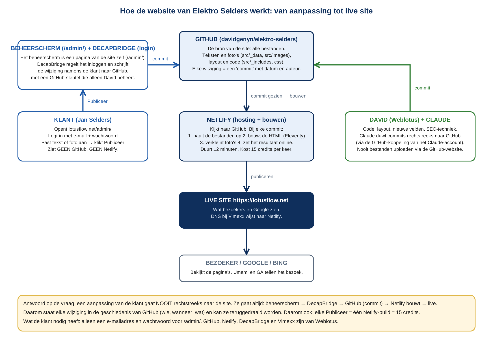
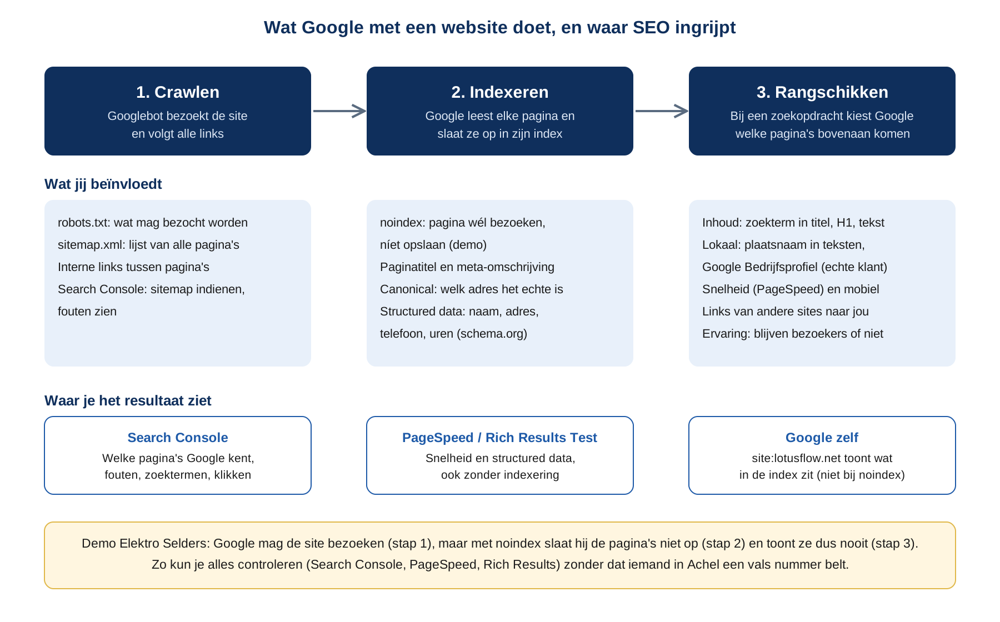

# Elektro Selders – demo-website (Weblotus)

Statische website voor een fictieve elektricien in Achel, gebouwd als demo van de Weblotus-dienst
"website die de klant zelf kan aanpassen, met SEO en statistieken". Live op **https://lotusflow.net**
(tijdelijk; gaat na de demo offline, zie §9).

Inhoud: 1 Hoe het werkt · 2 Accounts · 3 Wijzigingen doorvoeren · 4 Netlify · 5 Statistieken ·
6 SEO · 7 GEO · 8 Lokaal werken · 9 Afbouw · 10 Open punten. Klantenhandleiding: `docs/klant-handleiding.md`.

## 1. Hoe het werkt



Kern: **GitHub is de bron**, **Netlify bouwt en host**, **DecapBridge laat de klant zonder GitHub-account
schrijven**. Een aanpassing van de klant gaat nooit rechtstreeks naar de site; ze gaat altijd
beheerscherm → DecapBridge → commit in GitHub → Netlify bouwt (±2 min) → live. Daardoor staat elke
wijziging met naam en tijdstip in de GitHub-geschiedenis en kan ze teruggedraaid worden.

| Onderdeel | Wat het is en waarom | Waar |
|---|---|---|
| GitHub `davidgenyn/elektro-selders` | Alle bestanden van de site (teksten in YAML/Markdown, foto's, layout, code). Elke wijziging = commit | github.com |
| Eleventy 3 | De "bouwer": maakt uit de bestanden kant-en-klare HTML-pagina's en verkleint foto's | draait op Netlify bij elke commit |
| Netlify | Hosting + bouwen. Kijkt naar GitHub, bouwt bij elke commit, zet het resultaat online met SSL | app.netlify.com, team Weblotus, project `elektro-selders` |
| Decap CMS | Het beheerscherm `/admin/`: een pagina van de site zelf, met Nederlandse formulieren voor elke pagina | `https://lotusflow.net/admin/` |
| DecapBridge | 1. Inloggen van de klant (e-mail + wachtwoord). 2. Doorgeefluik: schrijft de wijziging in GitHub met een sleutel die alleen Weblotus beheert; de commit draagt de naam van de klant | decapbridge.com |
| Vimexx | Domein lotusflow.net; DNS `A @ → 75.2.60.5`, `CNAME www → elektro-selders.netlify.app`, plus TXT/CNAME-verificaties voor Google en Bing | vimexx.nl |
| SSL | Let's Encrypt via Netlify, vernieuwt automatisch | Netlify → Domain management |
| Contactformulier | POST JSON naar n8n-webhook op lotusserver (Tailscale Funnel), pad `/webhook/elektro-selders-contact` (workflow nog niet gemaakt) | `src/_data/site.yml` → `webhook` |
| Statistieken | Umami Cloud (cookieloos) + Google Analytics 4 (na toestemming via cookiebanner) | §5 |

## 2. Accounts en rollen

| Dienst | Account | Rol |
|---|---|---|
| GitHub | davidgenyn | eigenaar repository |
| Netlify | david.genyn@gmail.com, team Weblotus | eigenaar; **Personal-plan $9/mnd** sinds 10 nov 2026 |
| DecapBridge | david.genyn@gmail.com (Google-login) | **Owner**: enige die site-instellingen (login-URL, GitHub-sleutel) kan wijzigen |
| DecapBridge | lotusflow.contact@gmail.com (wachtwoord) | **Collaborator** = de "klant": kan inhoud bewerken, geen instellingen |
| Umami Cloud | lotusflow.contact@gmail.com (Google-login), regio EU, Hobby-plan | website "Elektro Selders", ID `3128268b-5f0e-4544-890c-76da63d4afc7` |
| Google Analytics | lotusflow.contact@gmail.com | property "Elektro Selders website", stream `lotusflow.net`, Measurement ID `G-ZGG925D6E5`, Google tag `GTM-5TJNBBFF` |
| Google Search Console | lotusflow.contact@gmail.com | domein-property `lotusflow.net`, geverifieerd via TXT bij Vimexx |
| Bing Webmaster Tools | lotusflow.contact@gmail.com (Google-login) | `https://lotusflow.net/`, geverifieerd via CNAME `84604c254ce6a627420a99c3b2a7f780 → verify.bing.com` |
| Vimexx | bestaand account | DNS lotusflow.net |
| WordPress.com | lotusflow.contact@gmail.com | **oude route, niet meer gebruikt; opzeggen vóór 26 nov 2026** |

Let op bij DecapBridge: ingelogd als collaborator zie je enkel "Go to CMS" en geen instellingen. Voor instellingen: uitloggen, inloggen met het owner-account (Google) → **Manage site** → tab **Settings**.

## 3. Wijzigingen doorvoeren

| Wat | Wie | Hoe | Deploy? |
|---|---|---|---|
| Teksten, foto's, bedrijfsgegevens, Google-titels, dienstpagina's | klant of David | `/admin/` → Pagina's, Dienstpagina's of Bedrijfsgegevens → **Publiceer** | ja, 1 per Publiceer |
| Layout, CSS, templates, nieuwe velden | David (met Claude) | commit op `main` via git; Claude duwt rechtstreeks naar GitHub via de GitHub-koppeling van het Claude-account (geen token nodig) | ja, 1 per commit |
| Nooit meer | – | losse bestanden of zips uploaden via de GitHub-website (Windows haalt de punt uit `.eleventy.js`, mappen gaan verloren) | – |

Netlify bouwt bij **elke** commit, dus ook bij een README-wijziging. Groepeer wijzigingen.

### Bestandsstructuur

```
eleventy.config.js       Eleventy-config: YAML-data, foto-optimalisatie (webp/jpeg 480/800/1200), inline CSS
netlify.toml             build-opdracht, Node 20, cache-headers (/img/ 1 jaar, /images/ 1 week), /admin/ noindex
package.json             @11ty/eleventy, @11ty/eleventy-img, js-yaml
src/_data/site.yml       bedrijfsgegevens, webhook, Umami-ID, Google tag, noindex-schakelaar
src/_data/home.yml, diensten.yml, overons.yml, contact.yml   inhoud per pagina (+ seo: titel/omschrijving)
src/dienstpaginas/*.md   dienstpagina's (installatie, storingen, energie) → /diensten/<slug>/; CMS-collectie "Dienstpagina's"
src/_includes/base.njk   layout: head (SEO, OG, schema.org Electrician, Umami), header, footer, cookiebanner
src/_includes/dienst.njk layout van een dienstpagina (secties, lijst, FAQ + FAQPage-schema)
src/index.njk, diensten.njk, over-ons.njk, contact.njk, privacy.njk, sitemap.njk
src/admin/config.yml     Decap-configuratie (collecties, Nederlandse labels, DecapBridge-backend)
src/css/style.css        huisstijl wit/blauw (#0F2F5C, #1E5AA8, #E8F0FA)
src/images/logo.png      logo; src/images/uploads/  foto's van de klant (via CMS)
src/robots.txt           Allow /, Disallow /admin/, AI-crawlers toegelaten, Sitemap
docs/                    schema's (PNG) en klantenhandleiding
dossier/, lab/           CyFun Small-documenten (cybersecurity-spoor, los van de website; niet gebouwd)
```

## 4. Netlify: plan en credits

| Feit | Waarde |
|---|---|
| Kost per geslaagde productie-deploy | 15 credits |
| Free-plan | 300 credits/mnd = 20 deploys; bij 0 gaat de site **offline** tot de volgende maand; bijkopen kan niet |
| Personal-plan (huidig) | $9/mnd, 1.000 credits = 66 deploys; maandelijks, verlengt automatisch |
| Auto recharge | **uit laten** (anders worden automatisch credits bijgekocht) |
| Stoppen | Usage & billing → **Billing details** → link "first downgrade this team to a **Free Plan →**" |
| Regel voor echte klanten | Free-plan nooit gebruiken; Personal (1 klant) of Pro ($20, 3.000 credits) |

## 5. Statistieken

| | Umami Cloud | Google Analytics 4 |
|---|---|---|
| Cookies / toestemming | geen cookies, geen banner nodig (standpunt Umami; data in EU) | cookies → banner met Aanvaarden/Weigeren verplicht (ePrivacy/AVG) |
| Geblokkeerd door adblockers | zelden | vaak (AdGuard blokkeerde het bij de test) → GA telt die bezoekers niet |
| Prijs | Hobby $0 (1 site, 100.000 events/mnd, 6 mnd bewaring); Pro $20/mnd (20 sites, 1 M events, 2 jaar) | gratis |
| Dashboard | cloud.umami.is | analytics.google.com → Reports → Realtime / Reports snapshot |
| Events | `bel`, `mail` (links), `formulier` (verzonden) | automatisch: page_view, scroll, outbound click, … |
| Uitzetten | veld "Umami website-ID" leegmaken in Bedrijfsgegevens | veld "Google tag" leegmaken → ook de banner verdwijnt |

Een *event* = één meting (paginaweergave of klik). *Bewaartijd* = hoe lang de geschiedenis bewaard blijft.

Cookiebanner: eigen code in `base.njk`; keuze in `localStorage` (`es_consent`). Bij Weigeren of geen keuze wordt niets van Google geladen. Keuze opnieuw: browsergegevens van de site wissen.

Wat "is mijn site rendabel" betekent: bezoekers + herkomst (Google, direct) + conversies (bel, mail, formulier). Alle drie geven dat; GA4 heeft enkel meerwaarde als de klant Google Ads gebruikt.

## 6. SEO: vindbaar in Google en Bing

### 6.1 Hoe zoekmachines werken en waar je ingrijpt



| Stap | Wat Google/Bing doet | Wat de site daarvoor heeft |
|---|---|---|
| 1 Crawlen | Een robot bezoekt de site en volgt links | `robots.txt` (alles toegelaten behalve `/admin/`), `sitemap.xml` met alle 7 pagina's, interne links Home → Diensten → dienstpagina's |
| 2 Indexeren | Leest elke pagina en slaat ze op | per pagina titel + meta description (via CMS "Google-instellingen"), canonical, Open Graph, `lang="nl-BE"`, structured data (§6.3), `noindex`-schakelaar |
| 3 Rangschikken | Kiest bij een zoekopdracht welke pagina's bovenaan komen | inhoud met plaatsnamen, snelheid (PageSpeed 100), mobiel, FAQ's; de rest (profiel, reviews, links) ligt buiten de site (§6.5) |

### 6.2 Wat in de site zit (techniek, klaar)

| Punt | Waar | Controle |
|---|---|---|
| Titel + meta description per pagina | CMS → elke pagina → "Google-instellingen"; dienstpagina's: "Google-titel"/"Google-omschrijving" | Paginabron: `<title>`, `<meta name="description">` |
| Canonical, Open Graph, `lang="nl-BE"` | `base.njk` | Paginabron |
| Sitemap | `src/sitemap.njk` → `/sitemap.xml` (7 adressen, dienstpagina's automatisch) | `https://lotusflow.net/sitemap.xml` |
| robots.txt | `src/robots.txt` | `https://lotusflow.net/robots.txt` |
| Snelheid | `@11ty/eleventy-img` (webp + srcset, width/height), inline CSS, cache-headers in `netlify.toml` | PageSpeed Insights mobiel 10–11 nov 2026: Prestaties 100, Toegankelijkheid 100, Praktische tips 100, SEO 100 |
| Toegankelijkheid | koppenvolgorde h1→h2→h3, links onderstreept | PageSpeed → Toegankelijkheid |
| Lokale signalen | plaatsnamen in titels, hero, werkgebied, dienstteksten (Achel, Hamont-Achel, Pelt, Lommel, Bocholt, Peer) | – |
| Aparte dienstpagina's | `/diensten/installatie/`, `/storingen/`, `/energie/`, elk met eigen titel, H1, tekst, lijst, FAQ | – |

Snelheidsles: foto's van 1–3 MB zonder `width/height` gaven score 75; eleventy-img en inline CSS brachten het op 100. Foto's van de klant mogen groot zijn; de build verkleint ze.

### 6.3 Structured data (schema.org)

| Schema | Waar | Wat Google ermee doet |
|---|---|---|
| `Electrician` (= LocalBusiness): naam, adres, telefoon, e-mail, uren, werkgebied, logo | `base.njk`, op elke pagina, gegevens uit Bedrijfsgegevens | herkent een lokaal bedrijf in Achel; Rich Results Test: "Lokale bedrijven" + "Organisatie" geldig |
| `FAQPage`: vragen + antwoorden | `diensten.njk` en `dienst.njk` | leest de vraag-antwoordparen; toont ze sinds 2023 niet meer als uitgebreid resultaat voor gewone bedrijven, maar AI-zoekers gebruiken ze wel (§7) |
| Optioneel, niet gedaan | `image`, `priceRange` op Electrician | Rich Results Test meldt ze als "niet-kritiek" |

Controle: `https://search.google.com/test/rich-results` met een pagina-adres.

### 6.4 Registraties en wat ze tonen

| Dienst | Stand | Gebruik |
|---|---|---|
| Google Search Console | domein-property `lotusflow.net`; TXT `google-site-verification=…` bij Vimexx; sitemap ingediend 10 nov; indexering aangevraagd. Eerste dag "Blocked by robots.txt" = Google's cache van de oude WordPress-robots.txt; lost zich binnen 24 u op → URL inspection → Request again | **Performance**: vertoningen, kliks, positie per zoekterm (na 1–3 weken). **Pages**: welke pagina's in de index zitten. **Links**: wie naar de site linkt. **Removals**: site tijdelijk uit Google halen |
| Bing Webmaster Tools | geïmporteerd uit Search Console, CNAME-verificatie, sitemap gekend | zelfde rapporten voor Bing; **AI Performance (beta)**: vermeldingen in Copilot/ChatGPT |
| `noindex`-schakelaar | Bedrijfsgegevens → "Verbergen voor Google". **Uit** sinds 10 nov 2026 (vindbaarheidstest); na de demo **aan** | bij een echte klant altijd uit |

### 6.5 Wat de positie écht bepaalt (buiten de site; per echte klant)

| Factor | Wat | Wie | Demo |
|---|---|---|---|
| Google Bedrijfsprofiel + reviews | de kaartvermelding met sterren; voor lokale zoekopdrachten zwaarder dan de site zelf. Verificatie per brief/video op het adres | klant, met hulp van Weblotus | ✗ fictief bedrijf: niet mogelijk, en tegen Google's regels |
| Inhoud | per dienst een pagina met echte tekst, prijzen, foto's van eigen werk, FAQ, plaatsnamen | klant schrijft, Weblotus structureert | ✅ 3 dienstpagina's |
| Links van andere sites | leveranciers, gemeente, beroepsvereniging, lokale pers, portfolio van Weblotus | klant/Weblotus | te doen: link vanaf weblotus.be |
| Kliks (CTR) | goede titels en omschrijvingen → meer kliks → hogere positie | Weblotus schrijft | ✅ |
| Gedrag | blijven bezoekers, bellen ze | gevolg van inhoud + snelheid | ✅ snelheid |
| Tijd | nieuw domein heeft maanden nodig | niemand | – |
| Google Ads | betaald meteen bovenaan | klant betaalt per klik | ✗ |

Niemand kan een eerste plaats beloven. Dit is een **maandelijkse dienst** (profiel beheren, reviews vragen, 1 pagina per maand, Search Console nakijken), apart van "website bouwen".

Eerlijke verwachting voor de demo: zonder Bedrijfsprofiel en zonder vermeldingen elders haalt een nieuw domein in 1–2 maanden geen eerste pagina; wat je wél ziet is of en hoe de site opgenomen wordt en voor welke termen.

## 7. GEO: vindbaar in AI-antwoorden

GEO = Generative Engine Optimization: genoemd worden in antwoorden van Google AI Overviews, ChatGPT,
Perplexity, Copilot. Het vak is jong; de rangschikkingsregels zijn niet publiek. Wat vaststaat is **hoe die
systemen aan bronnen komen**, en daar is op ingespeeld.

| Hoe de AI aan antwoorden komt | Gevolg | Stand |
|---|---|---|
| Google AI Overviews / Gemini gebruiken de Google-index | zelfde werk als SEO (§6) | ✅ |
| ChatGPT-zoeken en Copilot gebruiken de **Bing**-index | site moet in Bing staan | ✅ Bing Webmaster Tools |
| Perplexity, OpenAI, Anthropic crawlen zelf | hun robots mogen niet geblokkeerd zijn | ✅ `robots.txt`: GPTBot, OAI-SearchBot, ChatGPT-User, PerplexityBot, ClaudeBot, Google-Extended, Bingbot uitdrukkelijk toegelaten |
| AI citeert liefst korte, feitelijke vraag-antwoordtekst | FAQ-blokken + `FAQPage`-schema | ✅ op Diensten en de 3 dienstpagina's |
| AI "vertrouwt" bedrijfsfeiten die overal hetzelfde zijn | naam, adres, telefoon, uren, werkgebied op elke pagina + `Electrician`-schema | ✅ |
| Vermeldingen op andere sites (Bedrijfsprofiel, gidsen) wegen zwaar | – | ✗ niet mogelijk voor een fictief bedrijf |
| `llms.txt` (voorstel 2024: tekstbestand dat de site samenvat voor AI) | – | niet gedaan: geen grote AI heeft bevestigd het te gebruiken |

Meting (vanaf 2–4 weken na 11 nov 2026):

| Waar | Wat |
|---|---|
| ChatGPT, Perplexity, Google (AI-overzicht) | vraag "elektricien in Achel" / "elektricien Hamont-Achel laadpaal"; noteer of lotusflow.net genoemd wordt |
| Bing Webmaster Tools → AI Performance | vermeldingen in Copilot/ChatGPT |
| Umami → Herkomst | bezoek uit chatgpt.com, perplexity.ai, copilot |

Resultaat hier noteren: _(nog leeg)_

## 8. Lokaal werken (optioneel)

```
npm install
npm start                 # site op http://localhost:8080
# beheerscherm zonder login: local_backend: true in src/admin/config.yml, dan in 2e venster:
npm run cms
```

## 9. Afbouw na de demo (site onvindbaar maken en kosten stoppen)

| # | Doe | Effect | Uitgevoerd |
|---|---|---|---|
| 1 | Portfolio-screenshots maken (7 pagina's × desktop/mobiel, lokaal gebouwd uit GitHub, zonder "TestSite" en zonder cookiebanner) | materiaal voor weblotus.be | ✅ 17 nov 2026 |
| 2 | Bedrijfsgegevens → "Verbergen voor Google" **aan** → Publiceer | `noindex` op elke pagina; Google en Bing laten de site vallen bij de volgende crawl (dagen) | ✅ 17 nov 2026 |
| 3a | Search Console → Removals → New request → `https://lotusflow.net/` → "Remove entire site" | meteen uit Google, ±6 maanden, terug te draaien | ✅ 18 nov 2026 |
| 3b | Bing Webmaster Tools → Configuration → Block URLs → `https://lotusflow.net/`, URL type **Directory**, Block type **URL & Cache** | uit Bing (en dus Copilot/ChatGPT-zoeken), 90 dagen; Bing mailt 8 dagen vooraf | ✅ 18 nov 2026 |
| 4 | Netlify → project verwijderen; Usage & billing → Billing details → Free Plan | site offline, $9/mnd stopt (vóór een maandgrens: 10 dec, 10 jan, …) | nog niet |
| 5 | Vimexx → DNS: A-record en CNAME van Netlify verwijderen; TXT (Google) en CNAME (Bing) mogen weg | domein vrij | nog niet |
| 6 | Umami-website en GA-property mogen blijven (gratis) of verwijderd worden | – | nog niet |

Les bij 3a: in een **domein**-property weigert Removals elke aanvraag met "URL not in property", ook met het volledige
adres. Oplossing: Search Console → property-keuze → Add property → **URL prefix** → `https://lotusflow.net/`
(automatisch geverifieerd omdat het domein al geverifieerd is) → daar Removals → Google biedt dan "Remove entire site".

Repository blijft bestaan als sjabloon voor echte klanten.

## 10. Open punten

| Punt | Status |
|---|---|
| Search Console: 4 pagina's geïndexeerd op 16 nov; daarna afbouw gestart (§9) | afgesloten |
| Link vanaf weblotus.be naar lotusflow.net | te doen |
| GEO-meting (§7) | vervalt: site is sinds 18 nov uit Google en Bing gehaald |
| n8n-workflow voor het contactformulier (Webhook → e-mail) | later |
| Schema-velden `image`, `priceRange` | optioneel |
| WordPress.com Premium opzeggen | **vóór 26 nov 2026** |
| Portfolio-screenshots voor weblotus.be | ✅ gemaakt 17 nov 2026 (bij David) |
| Netlify Personal terugzetten naar Free | bij de afbouw, vóór een maandgrens |
