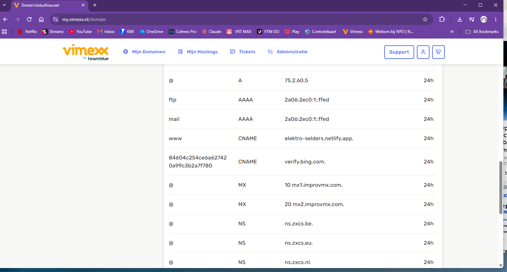
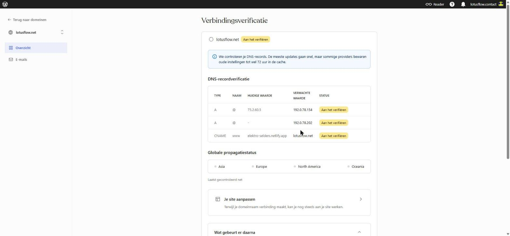
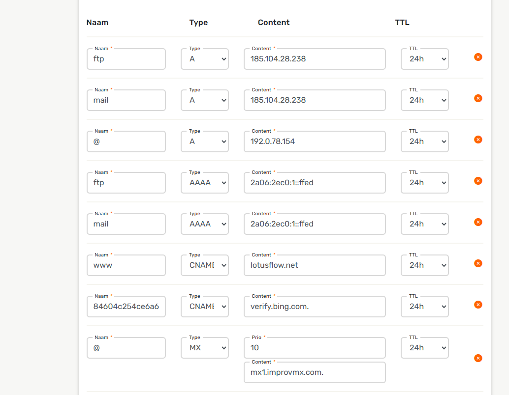
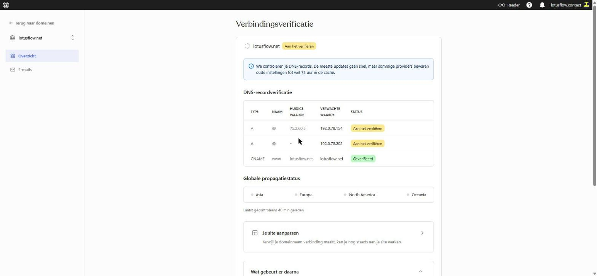
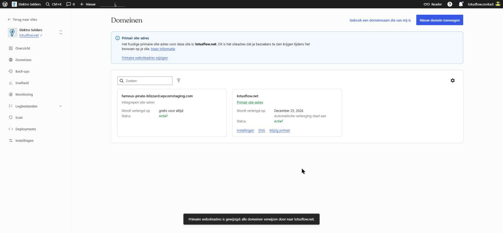
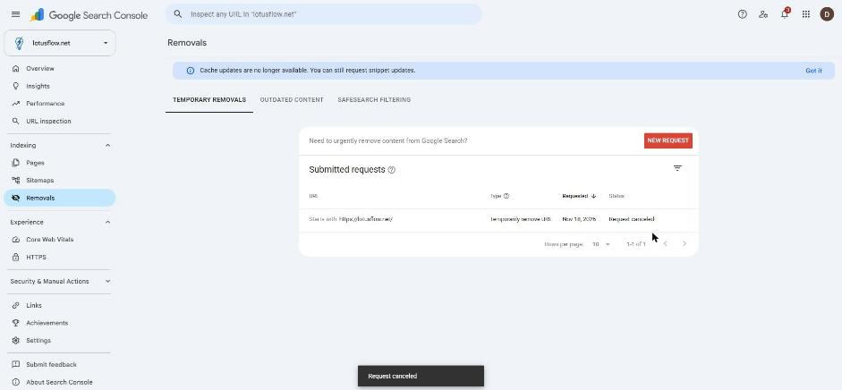

# Eigen domein koppelen, site lanceren, Netlify stopzetten

Handleiding bij wat op 25 november 2026 gedaan is voor **lotusflow.net** → WordPress.com-site
`famous-pirate-blizzard.wpcomstaging.com` (Elektro Selders, plan Premium). Zo kun je het de volgende
keer zelf, voor een echte klant.

Volgorde: **1 domein koppelen in WordPress.com → 2 DNS aanpassen bij de registrar → 3 wachten op
verificatie → 4 site lanceren → 5 oude hosting stopzetten.** Niet omgekeerd: zet je eerst de DNS om,
dan wijst het domein naar WordPress.com terwijl dat het domein nog niet kent.

Wat er vooraf stond bij Vimexx (DNS van lotusflow.net, nog naar Netlify):

## 1. Domein koppelen in WordPress.com

1. Log in op WordPress.com met het account van de klant (hier: lotusflow.contact@gmail.com).
2. Ga naar `https://wordpress.com/domains/add/use-my-domain/<site-adres>` of via het dashboard:
   **Upgrades → Domeinen → Domein toevoegen → Gebruik een domein dat je al bezit**.
3. Scherm "Voer je domein in": typ het domein (`lotusflow.net`) → **Doorgaan**.
4. Scherm "Je domein instellen" met twee kaarten:
   - *Draag je domeinnaam over naar WordPress.com* — domein verhuist naar WordPress.com als registrar,
     duurt 5–7 dagen. **Niet gekozen.**
   - *Koppel je domeinnaam aan deze site* — domein blijft bij Vimexx, alleen DNS wijst naar
     WordPress.com. **Dit gekozen.** (Het koppelen zelf kostte niets op het Premium-plan.)
5. Je komt op **Verbindingsverificatie** (`my.wordpress.com/domains/<domein>/domain-connection-setup`).
   WordPress.com toont per record de *huidige* en de *verwachte* waarde. Dit zijn de waarden die je
   bij de registrar moet zetten; neem ze over van dit scherm, niet uit een handleiding.

Voor lotusflow.net vroeg WordPress.com:

| Type | Naam | Waarde |
|---|---|---|
| A | @ | 192.0.78.154 |
| A | @ | 192.0.78.202 (tweede A-record, erbij) |
| CNAME | www | lotusflow.net |

## 2. DNS aanpassen bij Vimexx

my.vimexx.nl → **Mijn Domeinen** → het domein → sectie **DNS** → knop **DNS wijzigen**.

Wijzigen:
- het A-record `@` (stond op `75.2.60.5`, Netlify) → `192.0.78.154`
- het CNAME-record `www` (stond op `elektro-selders.netlify.app.`) → `lotusflow.net.`

Toevoegen (**Nieuw record toevoegen** onderaan de lijst): naam `@`, type `A`, content `192.0.78.202`,
TTL 24h. Dan **Opslaan**. Vimexx meldt "De DNS records zijn geupdate en binnen 2 a 4 uur actief".

**Niet aanraken** — die horen niet bij de website:
- `MX` (improvmx) en `TXT v=spf1…`, `_dmarc`, `_domainkey`: e-mail
- `NS` (zxcs): nameservers van Vimexx
- `TXT google-site-verification=…`: Google Search Console
- `CNAME …verify.bing.com.`: Bing Webmaster Tools
- `ftp`, `mail` A/AAAA: Vimexx-hosting, onschadelijk

Resultaat (het tweede A-record is daarna nog toegevoegd):

Let op bij Vimexx: bovenaan het domein stond **"Wordt opgezegd op 05-09-2027"** met een knop
"Opzegging annuleren". Dat betekent dat het domein niet automatisch verlengd wordt. Bij een echte
klant: nakijken.

## 3. Wachten op verificatie

Terug op het scherm Verbindingsverificatie in WordPress.com staat per record "Aan het verifiëren" of
"Geverifieerd". WordPress.com controleert zelf opnieuw en mailt als alles groen is; je hoeft niets te
doen. Vimexx zet de TTL op 24 uur, dus het kan tot een dag duren; WordPress.com noemt zelf 72 uur als
maximum.

## 4. Site lanceren

Zolang een WordPress.com-site niet gelanceerd is, staat hij op "Binnenkort beschikbaar": bezoekers
zien een wachtpagina en `robots.txt` is `Disallow: /`.

Lanceren: in het WordPress-dashboard (wp-admin) staat bovenaan de knop **Site lanceren**
(= `https://wordpress.com/setup/launch-site?siteSlug=<site-adres>`). Klik → "Je site is binnen enkele
ogenblikken live" → terug in het dashboard is de knop weg. Geen betaalstap op het Premium-plan.

Na lancering én domeinverificatie: controleer `https://<domein>/robots.txt` (mag niet meer
`Disallow: /` zijn) en bekijk de site in een privévenster.

## 5. Netlify stopzetten (oude Decap-hosting)

Beslissing 25 nov 2026: Netlify naar het **Free**-plan; de site mag blijven staan zolang hij gratis is.

app.netlify.com → team linksboven → **Usage & billing** → tab **Billing details** → bij plan Personal de
link **Free Plan →** → bevestigen. Op Free: 0 credits, de site gaat offline, geen kosten.
Let op: op het tabblad General staat alleen "Upgrade"; de downgrade-link staat op Billing details, in het vak
"Delete payment method". Gedaan op 25 nov 2026 (door David, in het david.genyn-profiel).
(Een site verwijderen: Site configuration → General → Danger zone → Delete site. Niet gedaan.)

## Na de verificatie: primair domein en vindbaarheid (gedaan 26 nov 2026)

Verificatie was op 26 nov om 12:24 volledig ("Actief", drie records "Geverifieerd"), ca. 20 uur na de DNS-wijziging.

Gedaan op 26 nov:
1. WordPress.com → Domeinen → **Primaire websiteadres wijzigen** → lotusflow.net → Adres wijzigen.
   Melding: "alle domeinen verwijzen door naar lotusflow.net". Het wpcomstaging-adres stuurt nu door.
2. Instellingen → Zichtbaarheid site: WordPress.com had de twee vinkjes zelf al uitgezet bij het wisselen van het
   primaire adres; `robots.txt` op lotusflow.net is nu normaal (`Disallow: /wp-admin/`) en Jetpack noemt er zijn
   sitemap `https://lotusflow.net/sitemap.xml` in. (Beslissing: eerst een week vindbaar, dan terug aan.)
3. Search Console (domein-property lotusflow.net, bestond nog van de Decap-demo): sitemap
   `https://lotusflow.net/sitemap.xml` opnieuw ingediend — zelfde URL als vroeger, dus Google leest hem vers.
4. Search Console → Removals: het verzoek "Remove entire site" van 18 nov (afbouw Decap-demo) stond nog op
   "Temporarily removed" en zou de site zes maanden uit Google houden → **Cancel request**. Status "Request canceled".

Les: bij het afbouwen van een demo op een domein dat later hergebruikt wordt, de verwijderingsverzoeken (Google
Removals, Bing Block URLs) noteren en ze bij de herlancering als eerste intrekken.

Nog te doen in Bing Webmaster Tools (inloggen vereist): Configuration → Block URLs → blokkering van
`https://lotusflow.net/` verwijderen; Sitemaps → `https://lotusflow.net/sitemap.xml` indienen.

Opgemerkt bij Domeinen: lotusflow.net toont "Wordt verlengd op 25 december 2026" — dat is WordPress.com's
domeinverbinding als product (Upgrades → Aankopen: "Inbegrepen bij abonnement", €0), niet de domeinnaam bij Vimexx.

**Kosten en einddatum (beslist 26 nov 2026):** WordPress.com Premium loopt **maandelijks aan € 18 excl. btw**
(niet de jaarprijs van ca. $8/maand uit de eerdere vergelijking). Vandaag verlengd tot 26 december 2026;
automatische verlenging daarna **uitgezet**. Na 26 december valt de site terug op het gratis plan: domeinverbinding
weg, eigen thema en plugins verwijderd, 13 GB opslag weg. Alles staat op GitHub; herbouwen = thema opnieuw via de
thema-editor + pagina's uit de patronen (zie README). Wie de demo langer wil, moet vóór 26 december verlengen.

**Agenda:** 3 december 2026 — in WordPress.com → Instellingen → Zichtbaarheid site de twee vinkjes
("Zoekmachines ontmoedigen", "Voorkom delen door derden") **terug aan** (demo uit Google en AI-crawlers).

### Oorspronkelijke instructie (geschreven vóór de verificatie)

Zolang het primaire domein het wpcomstaging-adres is, staan in WordPress.com → Instellingen →
Zichtbaarheid site de vinkjes **"Zoekmachines ontmoedigen"** en **"Voorkom delen door derden"** vast aan
(grijs, niet te wijzigen) en is `robots.txt` `Disallow: /`. Daarom, zodra alle records "Geverifieerd" zijn:

1. WordPress.com → Domeinen → lotusflow.net → **Als primair domein instellen**.
2. Instellingen → Zichtbaarheid site → beide vinkjes **uit** → Opslaan. (Beslissing 25 nov 2026: de site
   eerst een week vindbaar laten zijn, daarna de vinkjes terug aan.)
3. Controleer `https://lotusflow.net/robots.txt`.

## Wat nog volgt na de domeinkoppeling

- Search Console: de bestaande domein-property `lotusflow.net` blijft geldig (TXT-record staat nog);
  nieuwe sitemap indienen: `https://lotusflow.net/wp-sitemap.xml`. Noindex van de Decap-demo geldt
  niet voor de WordPress-site.
- Bing Webmaster Tools: zelfde, sitemap opnieuw indienen.
- PageSpeed en Rich Results Test pas op `https://lotusflow.net` draaien (op het wpcomstaging-adres
  blokkeert robots.txt beide).
