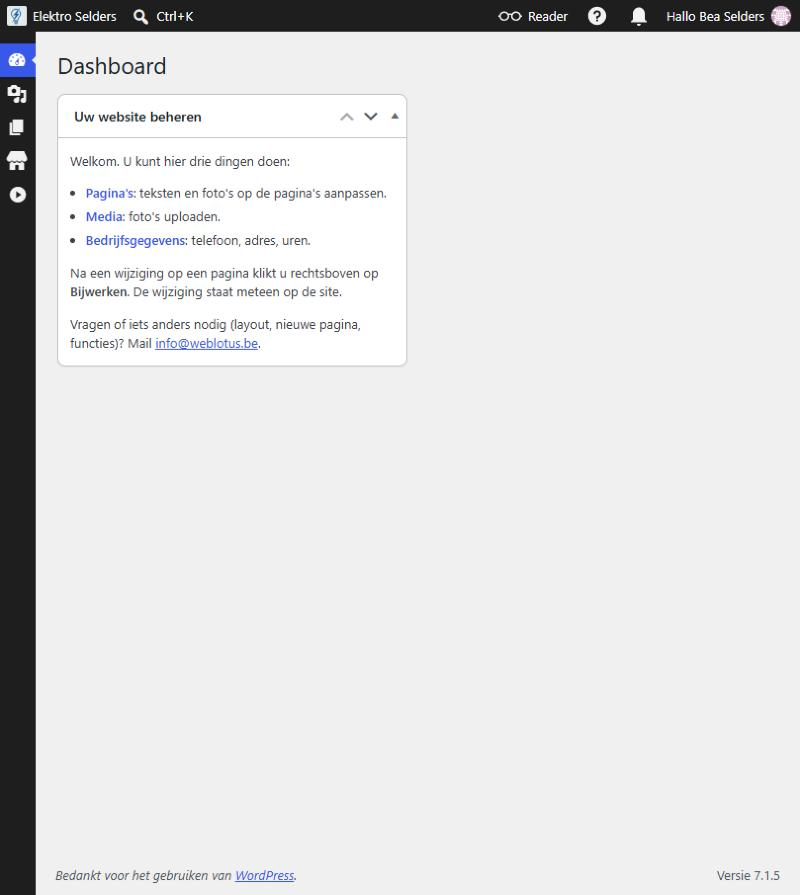
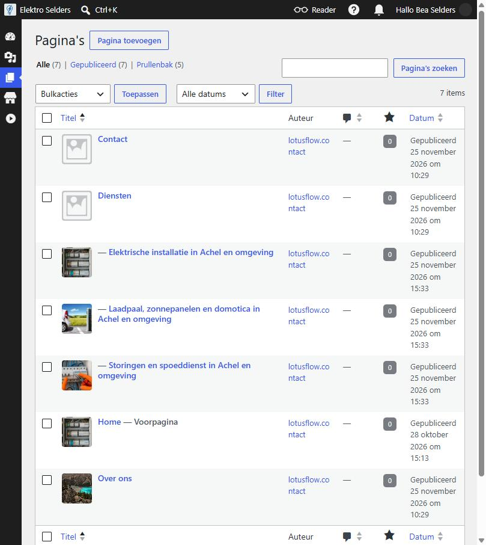
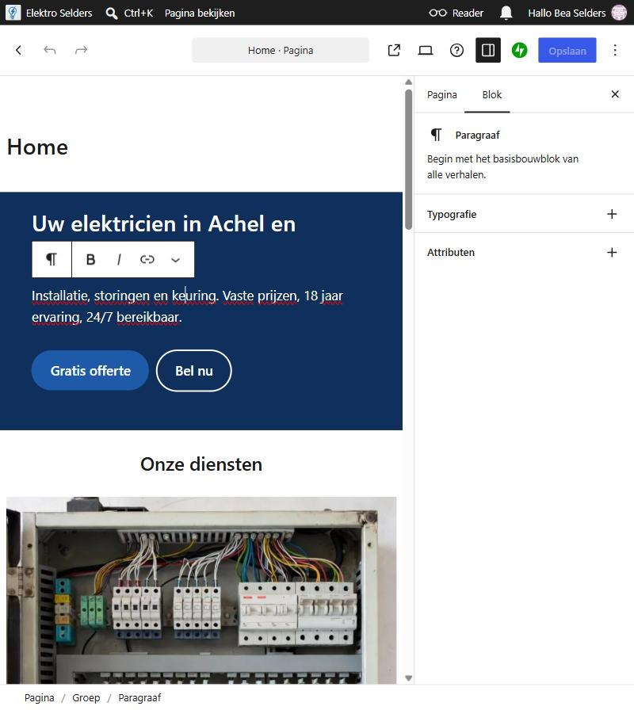
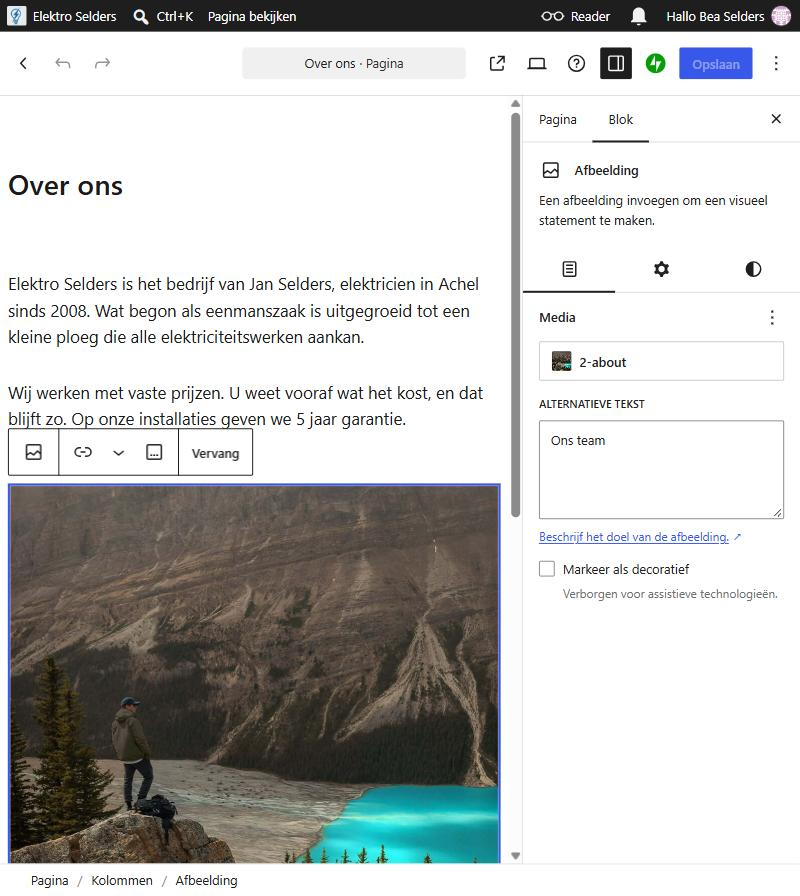
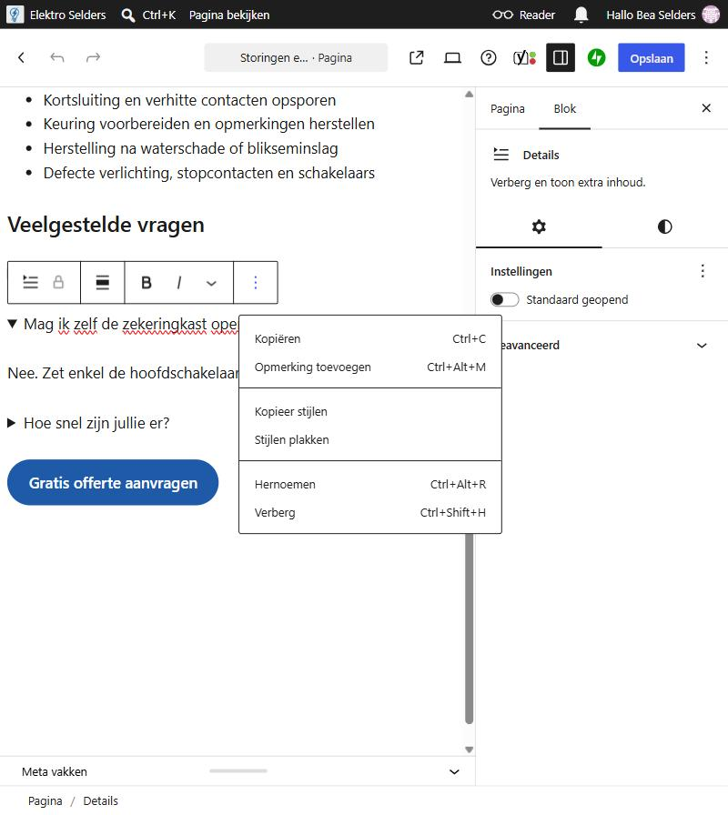
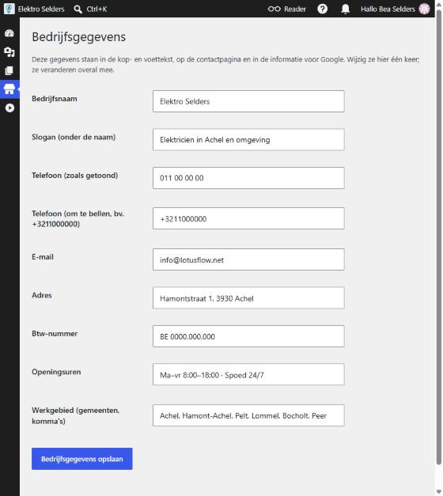

# Uw website zelf bewerken — handleiding voor de klant

Voor de website van Elektro Selders (WordPress, thema Weblotus). De schermen hieronder zijn die van
gebruiker **Bea Selders** (rol *Klant*), gemaakt op 25 november 2026.

U kunt drie dingen zelf doen: **teksten en foto's op de pagina's aanpassen**, **foto's uploaden** en de
**bedrijfsgegevens** (telefoon, adres, uren) wijzigen. Al de rest — de opmaak, het menu, de kop- en
voettekst, nieuwe functies — doet Weblotus. Zo kan er niets kapotgaan.

## 1. Inloggen

1. Ga naar `https://lotusflow.net/wp-login.php` (zolang het domein nog niet actief is:
   `https://famous-pirate-blizzard.wpcomstaging.com/wp-login.php`).
2. U ziet eerst een blauwe knop "Login met WordPress.com". Klik **niet** daarop, maar op de link eronder:
   **"Login met gebruikersnaam en wachtwoord"**.
3. Vul uw gebruikersnaam (`bea`) en wachtwoord in, los het rekensommetje op en klik **Inloggen**.
4. U komt op uw dashboard.

Links staan maar vier knoppen: Dashboard, Pagina's, Media en Bedrijfsgegevens. Meer hebt u niet nodig.

## 2. Een tekst aanpassen

1. Klik links op **Pagina's**. U ziet de lijst: Home, Diensten (met de drie dienstpagina's eronder),
   Over ons, Contact.

2. Klik op de naam van de pagina. De pagina opent in de editor.
3. Klik in de tekst die u wilt wijzigen en typ. U kunt een woord vet of cursief maken of een link
   toevoegen (knoppen boven de tekst). Blokken verplaatsen of verwijderen kan niet; dat is zo bedoeld.

4. Klik rechtsboven op **Opslaan**. De wijziging staat meteen op de site.

Tip: rechts onder "Pagina" staat het veld **Samenvatting**. Wat u daar typt (1–2 zinnen), gebruikt Google
als beschrijving onder de paginatitel in de zoekresultaten. Leeg laten mag; dan neemt de site het begin
van de tekst.

## 3. Een foto vervangen

1. Open de pagina in de editor en klik op de foto.
2. Boven de foto verschijnt een balkje met rechts de knop **Vervang**.

3. Klik op **Vervang** → **Mediabibliotheek openen** → kies een foto die al in de bibliotheek staat, of
   klik op **Bestanden uploaden** om een nieuwe foto van uw computer te kiezen.
4. Vul rechts bij **Alternatieve tekst** kort in wat op de foto staat (bv. "Nieuwe zekeringkast in Achel").
   Dat helpt Google en mensen met een schermlezer.
5. Klik rechtsboven op **Opslaan**.

**Foto's eerst verkleinen.** WordPress.com maakt grote foto's niet automatisch licht. Een foto van 1 MB
maakt de pagina traag op gsm. Maak de foto vóór het uploaden ongeveer **900 pixels breed** en bewaar als
**JPG** (of WebP), dan weegt hij 50–150 KB. Op Windows: foto openen in Foto's → "Formaat wijzigen" →
breedte 900. Liefst liggende foto's voor de dienstenkaarten.

## 4. Een vraag en antwoord (FAQ) aanpassen

Op de pagina Diensten en op de drie dienstpagina's staan "Veelgestelde vragen" als uitklapblokken.

1. Klik in de editor op de vraag en pas de tekst aan.
2. Klik op het driehoekje om het antwoord te openen, klik in het antwoord en pas het aan.
3. **Opslaan**.

Een vraag verwijderen of toevoegen kan u niet zelf; mail Weblotus. (In het menu met de drie puntjes staat
wel "Verberg": daarmee maakt u een vraag onzichtbaar op de site zonder ze te wissen. "Verberg" nog eens
aanklikken zet ze terug.)

## 5. Bedrijfsgegevens wijzigen

Klik links op **Bedrijfsgegevens**. Hier staan naam, slogan, telefoon, e-mail, adres, btw-nummer,
openingsuren en werkgebied. Wijzig wat nodig is en klik op **Bedrijfsgegevens opslaan**. Deze gegevens
veranderen in één keer overal: in de kop- en voettekst, op de contactpagina en in de informatie die
Google over het bedrijf leest.

Let op het veld "Telefoon (om te bellen)": dat is het nummer in internationale vorm
(`+3211000000`), zonder spaties. Het andere telefoonveld is hoe het nummer getoond wordt.

## 6. Wat u beter niet doet

- **Pagina toevoegen** (knop bovenaan de paginalijst): een nieuwe pagina staat niet in het menu en heeft
  geen opmaak. Wilt u een extra pagina, mail Weblotus.
- **Prullenbak**: de oude pagina's uit oktober staan daar; laat ze staan of laat Weblotus opruimen.
- Het paneel "Optimaliseer SEO" (Jetpack) in de zijbalk: hoeft u niet te gebruiken; de site regelt de
  zoekmachine-instellingen zelf.

## 7. Hulp nodig?

Iets anders nodig (nieuwe pagina, andere lay-out, formulier, boekingen)? Mail **info@weblotus.be**.
Wilt u dat Weblotus iets rechtstreeks in de site aanpast, dan geeft u daarvoor tijdelijk een login; de
site, het WordPress.com-account en de domeinnaam blijven van u.
