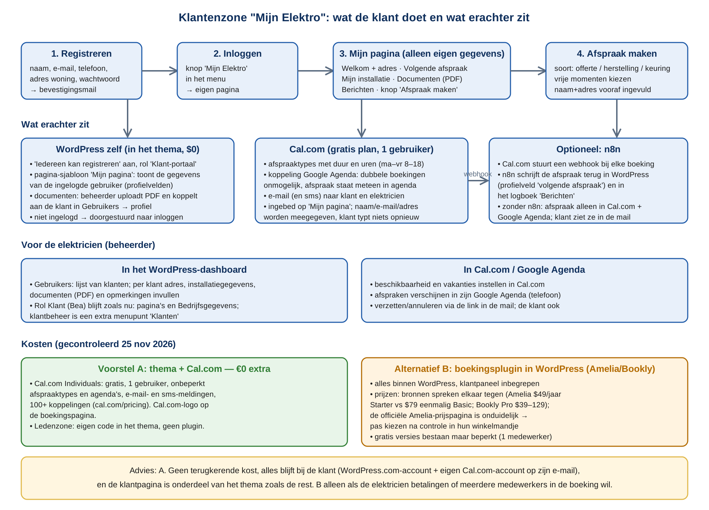
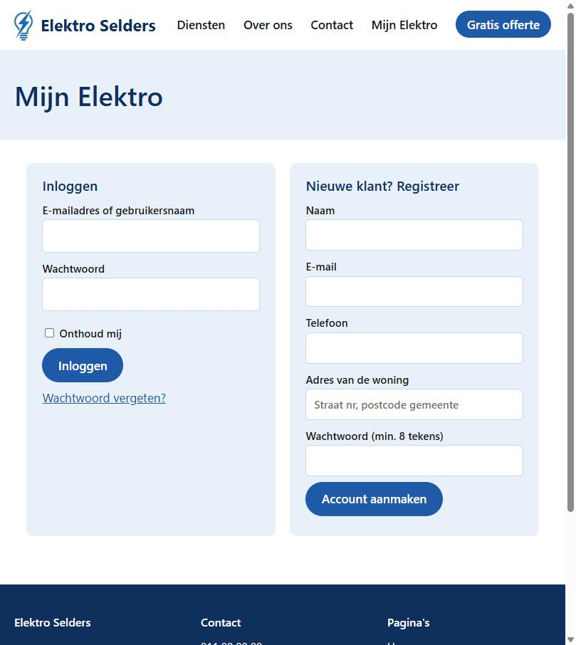
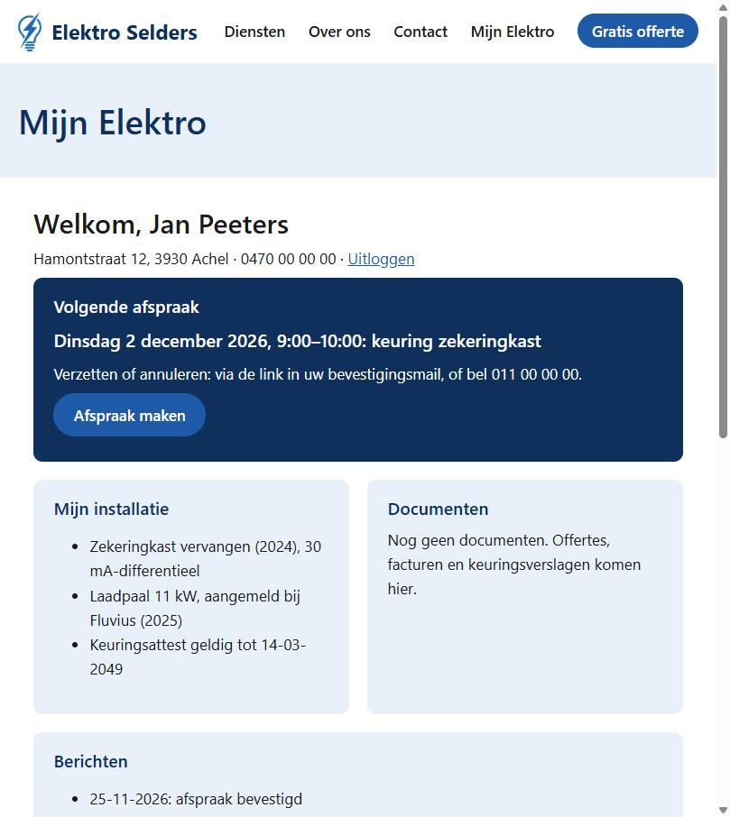
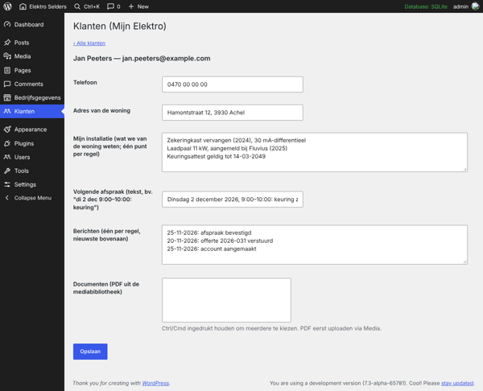

# Plan "Mijn Elektro" — klantenzone met afspraken (fase 3)

Beslist op 25 november 2026: voorstel A (klantenzone in het thema + Cal.com voor afspraken).
**Gebouwd op 25 november 2026 (thema v2.4)** en getest op de WordPress.com-site met testklant "Jan Peeters".
Nog open: het Cal.com-account van de klant (zie onderaan).

## Wat de klant ziet (fictieve demo-inhoud)

Knop **Mijn Elektro** in het menu, naast "Gratis offerte".

- **Registreren**: naam, e-mail, telefoon, adres van de woning, wachtwoord → bevestigingsmail.
- **Inloggen** → eigen pagina. Alleen eigen gegevens, nooit die van anderen.
- **Mijn pagina**, van boven naar onder:
  1. Welkom + adres, knop "Gegevens wijzigen"
  2. Volgende afspraak (bv. "di 2 dec, 9:00–10:00: keuring zekeringkast", verzetten/annuleren) of de knop
     **Afspraak maken**
  3. Mijn installatie: wat we van de woning weten (zekeringkast 2024, laadpaal 11 kW 2025, keuringsattest
     geldig tot 2049)
  4. Documenten: offertes, facturen, keuringsverslagen als PDF
  5. Berichten: korte historiek ("Offerte verstuurd", "Afspraak bevestigd")
- **Afspraak maken**: soort (offertebezoek 1 u / herstelling 1 u / keuring 2 u) → vrije momenten (ma–vr 8–18;
  spoed via telefoon) → bevestigen → mail naar klant en elektricien; afspraak in zijn Google Agenda. Naam,
  e-mail en adres worden meegegeven, de klant typt niets opnieuw.

## Hoe het gebouwd wordt

| Onderdeel | Waar | Kost |
|---|---|---|
| Registratie, login, rol "Klant-portaal", pagina-sjabloon "Mijn pagina", profielvelden (adres, installatie, documenten, berichten), menupunt "Klanten" voor de beheerder | eigen code in het thema (`functions.php` + sjabloon) | €0 |
| Afspraken: afspraaktypes, beschikbaarheid, Google Agenda-koppeling, mails/sms, boekingspagina | Cal.com, gratis plan "Individuals": 1 gebruiker, onbeperkt afspraaktypes en agenda's, e-mail- en sms-meldingen, 100+ koppelingen; Cal.com-logo op de boekingspagina (cal.com/pricing, 25 nov 2026). Account op het e-mailadres van de klant. | €0 |
| Optie (apart te betalen, niet in het basisaanbod): afspraak automatisch op Mijn pagina | n8n: webhook van Cal.com → profielveld "volgende afspraak" + logboek | automatiseringsdienst Weblotus |

Ingebed op "Mijn pagina" of als aparte boekingspagina (zoals motioncenter.be doet met Crossuite): nog te kiezen.

Alternatief B (niet gekozen): boekingsplugin in WordPress (Amelia/Bookly). Prijzen in bronnen tegenstrijdig
(Amelia $49/jaar Starter vs $79 eenmalig Basic; Bookly Pro $39–129); officiële Amelia-prijspagina onduidelijk.
Gratis versies beperkt tot 1 medewerker. Alleen zinvol bij betalingen of meerdere medewerkers in de boeking.

## Voorbeeld uit de praktijk

motioncenter.be (Tienen, gemaakt door Webhero): geen login of klantportaal; knop "Maak een afspraak" linkt
naar een externe boekingspagina van Crossuite (praktijksoftware); psychologen via intern aanmeldformulier.
Zelfde principe als voorstel A (site + aparte boekingstool), zonder de klantpagina.

## Gebouwd (thema v2.4) — hoe het werkt

- **Pagina's**: `/mijn-elektro/` met shortcode `[es_mijn_pagina]`, `/afspraak/` met `[es_afspraak]`. Beide staan in het
  menu (kop en voet) via het thema.
- **Rol `es_portaal` (Klant-portaal)**: wordt automatisch toegekend bij registratie. Geen dashboard: elke poging naar
  `/wp-admin/` stuurt door naar Mijn Elektro; geen admin-balk; na inloggen altijd naar Mijn Elektro.
- **Registreren**: eigen formulier op de pagina (naam, e-mail, telefoon, adres, wachtwoord ≥ 8 tekens), verborgen
  honingpotveld tegen bots, gebruikersnaam = deel vóór de @ van het e-mailadres. Welkomstmail naar de klant, melding
  naar het e-mailadres uit Bedrijfsgegevens. De klant is meteen ingelogd. (Geen activatielink; wie een fout adres
  opgeeft, krijgt gewoon geen mail.)
- **Inloggen**: standaard WordPress-formulier op de pagina, met "Wachtwoord vergeten?".
- **Mijn pagina**: welkom + adres/telefoon, Volgende afspraak (+ knop Afspraak maken), Mijn installatie, Documenten
  (PDF's), Berichten, Mijn gegevens wijzigen (telefoon en adres; naam/e-mail via de elektricien).
- **Beheer**: dashboard → **Klanten** (zichtbaar voor beheerders én de rol Klant/Bea): lijst van portaalklanten; per
  klant telefoon, adres, installatie (één punt per regel), volgende afspraak, berichten (één per regel), documenten
  (meerkeuzelijst van PDF's uit de mediabibliotheek — eerst uploaden via Media). Dezelfde velden staan ook op het
  gebruikersprofiel (Gebruikers) voor beheerders.
- **Afspraak maken**: pagina `/afspraak/` toont Cal.com in een kader zodra in **Bedrijfsgegevens** het nieuwe veld
  "Cal.com-link voor afspraken" ingevuld is (bv. `https://cal.com/<naam>/afspraak`). Naam, e-mail en adres/telefoon van
  de ingelogde klant worden meegegeven (`?name=…&email=…&notes=…`). Zonder link: tekst "Bel … of mail …".
- Gegevens zitten als gebruikersmeta (`es_tel`, `es_adres`, `es_installatie`, `es_afspraak`, `es_berichten`, `es_docs`).

## Cal.com opzetten (gedaan 25 nov 2026, account lotusflow.contact@gmail.com, link cal.com/lotusflow)

1. **Account**: cal.com → Sign up met het e-mailadres van de klant → gratis plan. Wizard: naam `Elektro Selders`,
   booking link (hier `lotusflow`), Google Calendar koppelen (stap 2, "Connected"), stap 3 "How you'll meet" →
   niets koppelen, **Finish** (een elektricien komt ter plaatse).
2. **Links** (= afspraaktypes): de drie voorbeelden (30 min, Secret, 15 min) verwijderen via ⋯ → Delete.
   **+ New** → Title / Description / Duration:
   - Offertebezoek — 60 — "Gratis en vrijblijvend bezoek bij u thuis om de werken te bekijken"
   - Herstelling — 60 — "Herstelling van een storing of defect bij u thuis"
   - Keuring — 120 — "Elektrische keuring of herstel van opmerkingen op het keuringsverslag"
   Per afspraaktype onder **Basics** → Location: "Cal Video" vervangen door **In Person (Attendee Address)**
   (adres van de klant; Google-adressuggesties, vrije tekst mag ook) → Save.
3. **Booking form** (per afspraaktype, menu links): labels in het Nederlands — "In Person (Attendee Address)" →
   `Adres van de woning` met placeholder `Straat en nummer, postcode gemeente`; "Your name" → `Naam`;
   "Email address" → `E-mailadres`; "Additional notes" → `Opmerking (optioneel)`.
4. **Availability** → Working Hours: ma–vr 8:00–18:00, weekend uit, Europe/Brussels (standaard stond 9–17).
5. **WordPress → Bedrijfsgegevens** → veld "Cal.com-link voor afspraken": `https://cal.com/lotusflow` → opslaan.
   Vanaf dan toont `/afspraak/` de drie afspraaktypes.

**Test 25 nov 2026**: registratie als nieuwe klant via Mijn Elektro (incognito), Afspraak maken → Offertebezoek →
dag en uur → naam/e-mail stonden vooraf ingevuld → adres ingevuld → Confirm. Boeking gelukt; bevestigingsmail bij de
klant, afspraak in de Google Agenda van lotusflow.contact en onder Cal.com → Bookings.
Let op: Cal.com weigert een e-mailadres dat niet bestaat ("This email address cannot receive mail"), dus testen met
een echt adres (bv. `lotusflow.contact+test@gmail.com`).

## Bekende beperkingen / nog te doen

1. De geboekte afspraak komt **niet automatisch** op de klantpagina; de elektricien vult "Volgende afspraak" in via
   dashboard → Klanten. Dat is zo bedoeld (beslissing 25 nov 2026): automatisering via n8n hoort niet bij het
   basisaanbod, want niet elke klant wil daarvoor betalen. Het kan als aparte, betaalde optie (Cal.com-webhook →
   WordPress REST).
2. `/afspraak/` gebruikt nu een eenvoudig `<iframe>`; in de browserpane van Claude reageerde dat niet op klikken
   (in een gewone browser wel). Vervangen door Cal.com's officiële embed-script staat op de lijst (thema v2.5).
3. Het adresveld van Cal.com wordt niet vooraf ingevuld (alleen naam, e-mail en de notitie met adres/telefoon).
4. De taal van de Cal.com-boekingspagina (knoppen "Confirm", "Back"): nog na te gaan of die per pagina vast te zetten is.
5. Testklanten (Jan Peeters, Jolien) en de demo-gegevens verwijderen vóór oplevering aan een echte klant.
